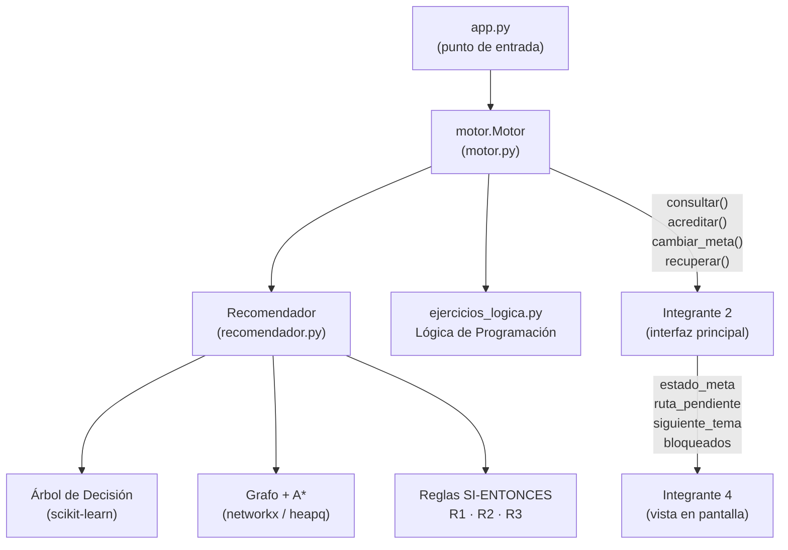

# Integrante 1 — Motor de Recomendación, A* y Arranque Local

## Archivos creados / modificados

| Archivo | Rol |
|---|---|
| [`motor.py`](file:///Users/hackerman/Documents/Integrador7M/Integrador7M/motor.py) | **API interna del motor** — punto de entrada único |
| [`app.py`](file:///Users/hackerman/Documents/Integrador7M/Integrador7M/app.py) | **Punto de entrada** — carga motor, abre interfaz Gradio |
| [`ejercicios_logica.py`](file:///Users/hackerman/Documents/Integrador7M/Integrador7M/ejercicios_logica.py) | Banco de ejercicios de **Lógica de Programación** |
| [`demo_integrante1.py`](file:///Users/hackerman/Documents/Integrador7M/Integrador7M/demo_integrante1.py) | Script de demostración — prueba los 10 escenarios |
| [`recomendador.py`](file:///Users/hackerman/Documents/Integrador7M/Integrador7M/recomendador.py) | *(sin cambios)* Motor original del equipo |

---

## Arquitectura del Motor



---

## API Pública del Motor (`motor.py`)

### `Motor.consultar(...)` — Recomendación completa + A*
Llámalo en:
- Diagnóstico inicial
- Cambio de meta
- Recuperación de simulación

**Devuelve además de lo normal:**
```python
{
  "estado_meta":    "En progreso" | "Meta completada",
  "ruta_pendiente": ["Lógica de Programación", "POO", ...],
  "siguiente_tema": "Lógica de Programación",
  "bloqueados":     ["Backend con Node.js", ...]
}
```

### `Motor.acreditar(tema, ...)` — Al aprobar un tema
Recalcula A* incluyendo el nuevo tema en `completados`. Llámalo cada vez que el estudiante acredite.

### `Motor.cambiar_meta(nueva_meta, ...)` — Al cambiar la meta
A* vuelve a correr con el nuevo destino.

### `Motor.recuperar(snapshot)` — Al reanudar simulación
Acepta el dict serializado guardado por la interfaz.

### `Motor.verificar_bloqueo_nodejs(completados)` — Verificación puntual
```python
{ "bloqueado": True, "requisitos_faltantes": ["POO", "PostgreSQL"], "mensaje": "..." }
```

### `Motor.ruta_directa(completados, meta, nivel)` — Solo A*, sin árbol
Útil para actualizar el widget de ruta sin reclasificar al estudiante.

---

## Coherencia Árbol ↔ Grafo

> Si el árbol clasifica «Avanzado» pero el estudiante no tiene los prerrequisitos del tema actual, el motor **sobreescribe** la acción con `"Estudiar prerrequisito"` y lo documenta en `motivos`. La interfaz siempre recibe una recomendación coherente con el estado real del grafo.

---

## Resultados

| Escenario | Resultado |
|---|---|
| A* desde cero hacia Node.js | Lógica → POO → PostgreSQL → Node.js (costos 18/12/8.4 según nivel) |
| Acreditar Lógica → ruta ajustada | Lógica desaparece, siguiente = POO ✓ |
| Node.js bloqueado (solo Lógica) | Faltan POO y PostgreSQL ✓ |
| Node.js bloqueado (Lógica + POO) | Falta PostgreSQL ✓ |
| Node.js desbloqueado (Lógica + POO + PostgreSQL) | DESBLOQUEADO ✓ |
| Meta completada | `estado_meta = "Meta completada"`, `ruta_pendiente = []` ✓ |
| Coherencia árbol ↔ grafo | Árbol dice Avanzado, motor corrige a "Estudiar prerrequisito" ✓ |
| Cambio de meta → Patrón MVC | POO → MVC (costo 6.0) ✓ |
| Recuperar simulación | Ruta recalculada desde snapshot ✓ |
| Ruta directa (solo A*) | PostgreSQL → Node.js ✓ |

---

## Ejercicios de Lógica de Programación (12 ejercicios)

| Categoría | IDs | Niveles |
|---|---|---|
| Condiciones | LOGICA-C01, C02, C03 | Principiante |
| Ciclos | LOGICA-L01, L02 (Principiante); L03, L04 (Intermedio) | P / I |
| Corrección de errores | LOGICA-E01, E02, E03 | Principiante |
| Integrador | LOGICA-I01 (Intermedio); LOGICA-I02 (Avanzado) | I / A |

Cada ejercicio incluye: `descripcion`, `pistas` progresivas, `solucion` de referencia.

---

## Arranque Local

```bash
# Arranque normal (abre el navegador)
python3 app.py

# Sin navegador
python3 app.py --no-browser

# Puerto personalizado
python3 app.py --port 8080

# Demo de verificación (sin Gradio)
python3 demo_integrante1.py
```

---

## Para otros integrantes

### → Integrante 2 (interfaz principal)
Llama a `Motor.consultar()` / `Motor.acreditar()` / `Motor.cambiar_meta()`.
Recibe: `estado_meta`, `ruta_pendiente`, `siguiente_tema`, `bloqueados`, `recursos`, `ruta_detalle`.

### → Integrante 4 (vista en pantalla)
Lee `resultado["estado_meta"]`:
- `"Meta completada"` → muestra pantalla de cierre, `ruta_pendiente = []`.
- `"En progreso"` → muestra ruta y siguiente tema.


> El motor no guarda estado internamente. Cada llamada es sin estado (stateless): el estado del estudiante viaja como parámetros (`completados`, `meta`, etc.). El guardado/restauración de sesión es responsabilidad de la interfaz (Integrante 2).
